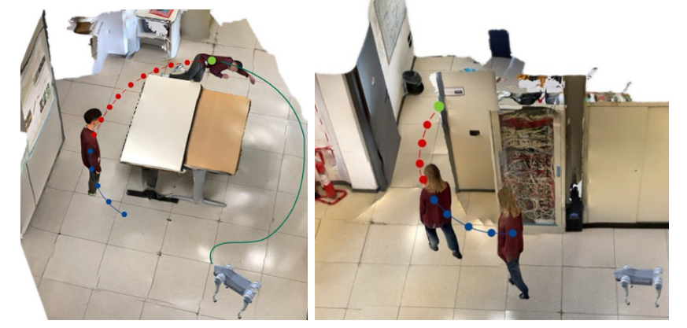
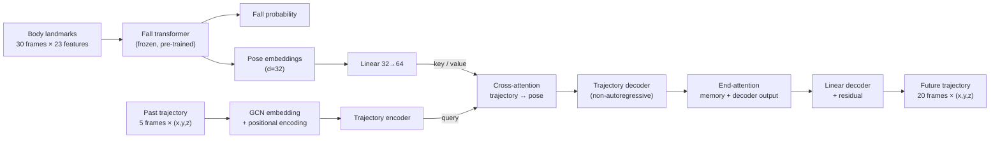

# WATCHDOG: Autonomous Elderly Assistance via Attention-based Fall Detection and Trajectory Prediction

[](https://ieeexplore.ieee.org/document/11696798)
[](https://antus8.github.io/WatchDog/)
[](LICENSE)

Official code for the paper **[WATCHDOG: Autonomous Elderly Assistance via Attention-based Fall Detection and Trajectory Prediction](https://ieeexplore.ieee.org/document/11696798)**.

WatchDog is an AI-powered legged robot that watches over elderly people in cluttered home environments. It combines two attention-based models: a **fall-detection transformer** that classifies short sequences of 2D body landmarks, and a **trajectory-prediction transformer** that uses the fall model's pose embeddings to forecast where the person will move next. A ROS package running on the robot extracts the person's skeleton and 3D position from an RGB-D camera.

<p align="center">
  
</p>

## Contents

- [Repository structure](#repository-structure)
- [Method overview](#method-overview)
- [Installation](#installation)
- [Data](#data)
- [Training](#training)
- [ROS implementation](#ros-implementation)
- [Baseline: Kalman filter](#baseline-kalman-filter)
- [Citation](#citation)
- [Acknowledgements](#acknowledgements)
- [License](#license)

## Repository structure

```
WatchDog/
├── Transformer/
│   ├── Fall_Detection/            # Fall-detection transformer (BodyClassificationNetwork)
│   │   ├── model.py               # Network: input embedding → transformer blocks → pooling → MLP → sigmoid
│   │   ├── trainer.py             # Training script
│   │   ├── inference.py           # Live fall detection from a webcam or video file
│   │   ├── performance_evaluation.py
│   │   ├── Dataset/               # Tools that build the fall dataset with MediaPipe
│   │   │   └── Extractors/        # One processor per public fall dataset
│   │   └── 3D_body_detection/     # MediaPipe 3D pose experiments
│   └── Trajectory_Prediction/     # WatchDog trajectory transformer (built on POTR / STPOTR)
│       ├── training/              # trainer.py (entry point), seq2seq_model_fn.py (train/eval loop)
│       ├── models/                # WatchPoseTransformer.py, Transformer.py, encoder/decoder, GCN embeddings
│       ├── data/                  # Human3.6M loader, skeleton and camera utilities
│       ├── utils/
│       └── trained_model/config/  # Hyper-parameters of the released model
├── ROS_implementation/
│   ├── 3d_human_detection/        # ROS 1 package: RGB-D skeleton tracking and 3D localization
│   └── watchdog_transformer/      # ROS wrapper for the transformer (coming soon)
├── Comparison/
│   └── Kalman Filter Trajectory Prediction/   # MATLAB Kalman filter baseline
└── docs/                          # GitHub Pages project website
```

## Method overview

The full model is `WatchPoseTransformer` (`Transformer/Trajectory_Prediction/models/WatchPoseTransformer.py`). It has two branches that run on every sample.



**1. Fall-detection branch** (`Transformer/Fall_Detection/model.py`, `BodyClassificationNetwork`)


Input: a 3-second window sampled at 10 Hz (30 frames). Each frame is a 23-dim vector: the normalized 2D image coordinates of 11 landmarks (face, shoulders, wrists, hips, knees, ankles) plus the body aspect ratio (height/width of the body bounding box).

**2. Trajectory-prediction branch** (`Transformer/Trajectory_Prediction/models/Transformer.py`)

Input: the last 5 observed 3D positions of the person's root joint (0.5 s at 10 Hz), expressed relative to the first observation.


**Training pipeline**

Starting from `Transformer/Trajectory_Prediction/training/trainer.py`, a training run goes through these steps:

1. `load_params()` defines the hyper-parameters, which are saved to `trained_model/config/config.json`. `fall_options` holds the fall-transformer architecture.
2. `H36MDataset_v3.dataset_factory()` loads Human3.6M 3D joints, subsamples them to 10 Hz, and projects them into each camera frame. For training subjects it applies augmentation: mirroring and synthetic viewpoints. The root joint becomes the trajectory, and the remaining joints become the root-relative pose.
3. `WatchModelFn`, a subclass of `seq2seq_model_fn.ModelFn`, builds the model with `WatchPoseTransformer.model_factory()`. This loads the frozen fall transformer from its checkpoint and sets up AdamW with a step LR schedule.
4. For each batch, `get_2d_mediapipe_landmarks()` turns the 3D Human3.6M skeleton of the last 30 frames into the same 23-dim landmark format the fall transformer expects. Only the trajectory branch receives gradients.


## Installation

The code was developed on Ubuntu with Python 3.8 and PyTorch.

```bash
git clone https://github.com/Antus8/WatchDog.git
cd WatchDog

conda create -n watchdog python=3.8
conda activate watchdog

# Install PyTorch for your CUDA version first (see https://pytorch.org/get-started/locally/), then:
pip install -r requirements.txt
```

> **Note:** the landmark extractors use the legacy `mediapipe.solutions.holistic` API, which recent MediaPipe releases removed. `requirements.txt` therefore pins an older MediaPipe version.

## Data

### Human3.6M (trajectory prediction)

The trajectory transformer is trained on [Human3.6M](http://vision.imar.ro/human3.6m/). Subjects S1, S5, S6, S7 and S8 are used for training, and S9 and S11 for testing.

1. Request access and download the dataset from the [official website](http://vision.imar.ro/human3.6m/).
2. Convert the 3D poses to the `data_3d_h36m.npz` format with the [VideoPose3D preprocessing script](https://github.com/facebookresearch/VideoPose3D/blob/main/DATASETS.md):
   ```bash
   # inside a VideoPose3D checkout
   cd data
   python prepare_data_h36m.py --from-source-cdf /path/to/h36m
   ```
3. Copy the resulting file to `Transformer/Trajectory_Prediction/data/data_3d_h36m.npz`. The skeleton metadata (`parent.json`, `offset.json`, `rot_ind.json`, `action_defs.json`) is already in `Transformer/Trajectory_Prediction/data/h3.6m/`.

### Fall dataset (fall detection)

The fall transformer was trained on a dataset of MediaPipe landmark sequences. We built it from several public fall datasets:

| Dataset | Processor (`Transformer/Fall_Detection/Dataset/Extractors/`) |
|---------|------------------------------------------------------------|
| [Le2i / ImViA](https://www.kaggle.com/datasets/tuyenldvn/falldataset-imvia) | `le2i_processor.py` |
| [UR Fall Detection](http://fenix.ur.edu.pl/~mkepski/ds/uf.html) | `ur_fall_processor.py` |
| [UP-Fall Detection](https://sites.google.com/up.edu.mx/har-up/) | `up_fall_processor.py` |
| [Multiple Cameras Fall (Montreal)](http://www.iro.umontreal.ca/~labimage/Dataset/) | `montreal_dataset_processor.py` |
| High Quality Fall Simulation Data <!-- TODO: add link --> | `fall_simulation_processor.py` |

Each sample is a 3-second window: 90 frames at 30 FPS, each a 23-dim landmark vector, followed by a binary label (fall / no fall). At training time it is subsampled to 30 frames at 10 Hz.

**Option A: download our processed dataset (recommended).**
Download `final_normalized_dataset.json` <!-- TODO: add download link --> and place it at `Transformer/Fall_Detection/Dataset/final_normalized_dataset.json`.

**Option B: rebuild it from the raw videos.**
1. Download the datasets above.
2. Set `dataset_path` and `out_path` at the top of each processor in `Dataset/Extractors/`, then run them to produce one JSON file per dataset.
3. Merge the files with `Dataset/dataset_merger.py`.
4. Normalize the body-aspect-ratio feature to [0, 1] with `Dataset/dataset_normalizer.py`.

### Pretrained weights [To be released soon]

<!-- TODO: add download links -->
- Fall transformer: `<best_model>.pth`
- WatchDog trajectory transformer: `<best_model>.pt`

## Training

> Update paths, such as `~/WatchDog/...` and `../runs/...`. Before running, check the paths noted in each step below.

### 1. Fall-detection transformer

```bash
cd Transformer/Fall_Detection
python trainer.py                 # reads ../Dataset/final_normalized_dataset.json, writes runs/train_1/weights/
tensorboard --logdir runs         # optional
python performance_evaluation.py  # confusion matrix and metrics on the validation split
python inference.py               # live demo on a webcam or video file
```

### 2. WatchDog trajectory transformer

The trajectory model loads the frozen fall transformer. Set `weights_path` in `WatchPoseTransformer.load_fall_transformer()` to your fall-transformer checkpoint, and make sure `Transformer/Fall_Detection` is importable as `fall_transformer` (for example, add a symlink or adjust the `from fall_transformer.model import ...` import).

```bash
cd Transformer/Trajectory_Prediction/training
python trainer.py
```

The hyper-parameters are in `load_params()` and `fall_options` inside `trainer.py`. These are the main ones:

| Parameter | Value | Description |
|-----------|-------|-------------|
| `source_seq_len` / `target_seq_len` | 5 / 20 | observed / predicted frames at 10 Hz (0.5 s → 2 s) |
| `model_dim_traj` | 64 | trajectory token dimension |
| `num_encoder_layers` / `num_decoder_layers` | 4 / 4 | |
| `num_heads` / `dim_ffn` | 8 / 2048 | |
| `traj_embedding_type` | `gcn_enc` | GCN encoder + linear decoder |
| `batch_size` / `learning_rate` / `max_epochs` | 32 / 1e-4 / 300 | AdamW, step LR schedule |

Checkpoints are written to `Transformer/Trajectory_Prediction/runs/test_1/`, and TensorBoard logs to `trained_model/tf_logs/`.


## Baseline: Kalman filter

`Comparison/Kalman Filter Trajectory Prediction` contains the MATLAB Kalman filter with least-squares velocity estimation that we compared against in the paper. `evaluation_samples.csv` holds the evaluation trajectories: the input row is followed by the ground-truth row. `run_kalman_ls.m` and `compute_ADE_FDE.m` reproduce the ADE/FDE numbers.

## Citation

If you find this work useful, please cite our paper:

```bibtex
@inproceedings{longo2026watchdog,
  title={WATCHDOG: Autonomous Elderly Assistance via Attention-based Fall Detection and Trajectory Prediction},
  author={Longo, A and Bono, A and Guaragnella, G and Boccadoro, P and Rana, A and Petitti, A and D’Orazio, T},
  booktitle={2026 IEEE International Conference on Robotics and Automation (ICRA)},
  pages={20685--20692},
  year={2026},
  organization={IEEE}
}
```

## Acknowledgements

The trajectory-prediction code builds on [STPOTR](https://github.com/mmahdavian/STPOTR) (MARS Lab, Simon Fraser University) and [POTR](https://github.com/idiap/potr) (Idiap Research Institute). The Human3.6M loading utilities come from [VideoPose3D](https://github.com/facebookresearch/VideoPose3D). We thank the authors for releasing their code.

## License

This project is released under the [GNU General Public License v3.0](LICENSE).
